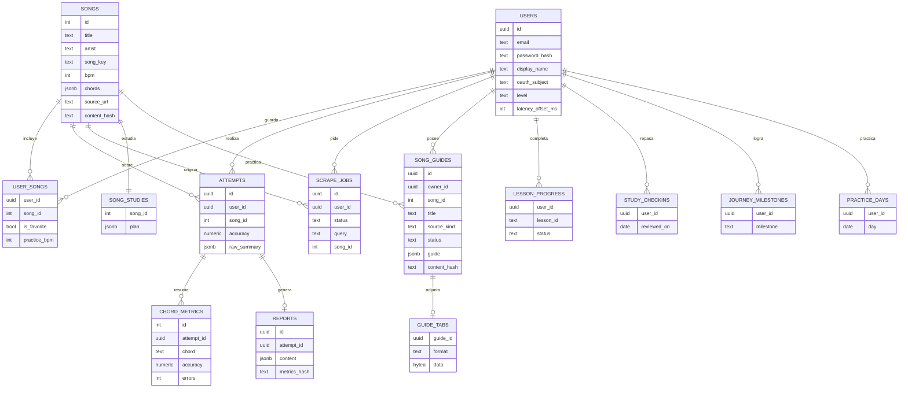

# Diagrama entidad-relación

Todas estas tablas están en el esquema `guitarcoach`. `public.schema_migrations` no aparece: es el historial del ejecutor, no un dato de la app. El audio no tiene tabla.

`song_key` evita la palabra reservada `key`. Los logros de la ruta no se guardan: la API los calcula a partir de intentos, guías, lecciones y días.

`GUIDE_TABS.data` es el archivo. Vive en su tabla para que `GET /guides` no lo traiga. Se borra con la guía.

Además de las tablas, `guitarcoach.chord_accuracy_summary` agrupa la precisión por acorde y `guitarcoach.problematic_transitions()` devuelve los pares consecutivos que salieron mal.
